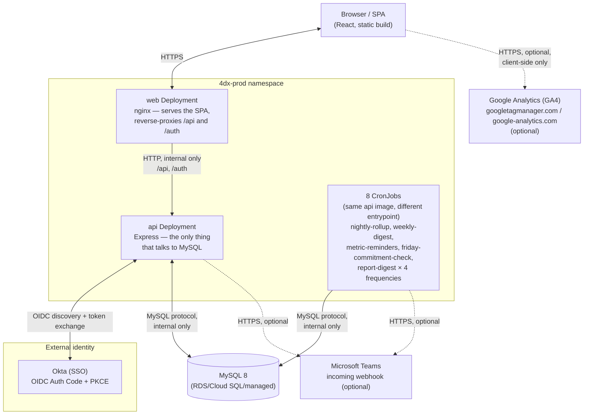
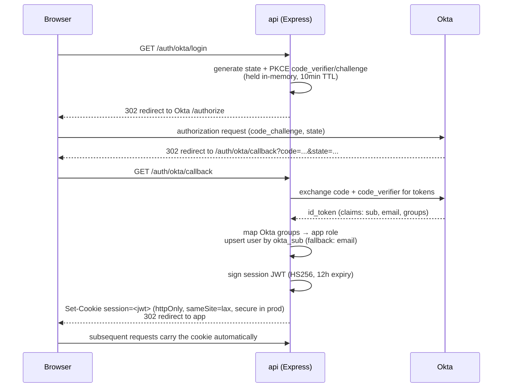
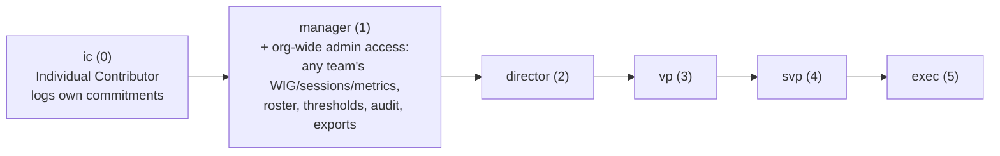
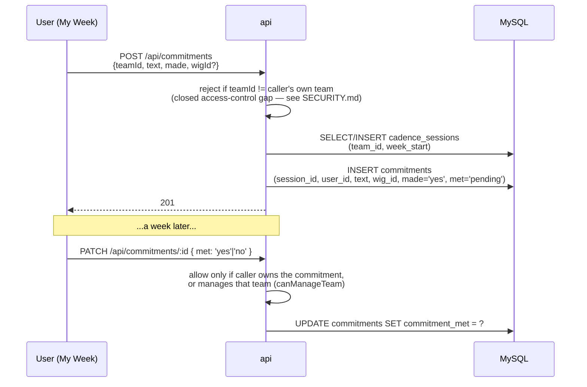

# 4DX Execution Tracker — Architecture

Companion files: [`db/schema.sql`](db/schema.sql) (MySQL DDL),
[`SECURITY.md`](SECURITY.md) (threat model, RBAC detail, hardening
changelog — read that alongside this doc if you're here for a security
review).

This document describes what's actually built and running, not a proposal.
Where something is a recommendation rather than shipped state, it's labeled
as such.

---

## 1. System overview

Two deployable units, one shared database — not three. There is no
separate "analytics service": all read/write/reporting logic lives in the
single `api` container, split into route modules
(`server/src/routes/*.js`) and shared query logic
(`server/src/lib/orgReports.js`) rather than a separate deployable.



- **web** — the React SPA, built once and served as static files by nginx.
  No secrets, no server-side logic, no database access. Reverse-proxies
  `/api/*` and `/auth/*` to the `api` service so the browser only ever talks
  to one origin.
- **api** — everything else: auth (Okta OIDC), all CRUD routes,
  analytics/rollup computation, and
  the entrypoint for every scheduled job. The scheduled jobs run as
  Kubernetes CronJobs using the *same built image*, just invoked with a
  different `command` (`node src/jobs/<name>.js`) instead of
  `node src/server.js` — there's no separate job-runner image to build or
  version-skew against the API.
- **MySQL** — never exposed outside the internal network in either
  deployment topology (no host port mapping in `docker-compose.yml`, no
  `LoadBalancer`/`NodePort` Service in `k8s/`).

See [`SECURITY.md`](SECURITY.md#threat-model--trust-boundaries) for the
NetworkPolicy-enforced version of this diagram (what's actually allowed to
talk to what, not just what's drawn here).

---

## 2. Data layer — MySQL

`db/schema.sql` is the single source of truth for the schema. Key tables,
grouped by what they model:

| Concern | Tables |
|---|---|
| Org structure | `teams` (self-referencing Division→Team via `parent_id`), `users` (with `role` and `manager_id` — see §4) |
| WIGs | `wigs` (lifecycle: `active`/`completed`/`on_hold`), `wig_measures` (1 lag + up to 3 lead per WIG), `wig_metric_readings` (monthly actuals) |
| Weekly cadence | `cadence_sessions` (one row per team per week), `commitments` (one row per person per session, optionally tagged to a `wig_id` — see §5) |
| Analytics cache | `team_week_scores` (read-through/write-back cache for the health-score history views — see below) |
| Config/audit | `org_config` (health-score thresholds), `audit_log` (who changed what), `user_preferences` (saved dashboard layout), `report_subscriptions` (scheduled digest opt-ins) |
| Reporting views | `v_individual_attainment_t4w`, `v_team_attainment_t4w` — trailing-4-week rollups, available for direct BI-tool access via a read-only DB user |

**`team_week_scores` is a cache, not a source of truth.** Weekly health
scores for *closed* weeks are computed once (by the `nightly-rollup`
CronJob, or on-demand on a cache miss) and read from this table afterward;
the current in-progress week is always recomputed live since it changes all
week. If this table is ever wiped or falls behind, every affected route
(`GET /api/analytics/org/heatmap`, `GET /api/analytics/team/:teamId/history`)
transparently recomputes from the raw `commitments`/`cadence_sessions` rows
and writes the result back — there's no manual backfill step required.

**Recommended, not yet automated**: managed instance (RDS/Cloud
SQL/Azure Database for MySQL) over a self-hosted StatefulSet, a read
replica once analytics query volume grows past what the primary comfortably
absorbs, and a real migration tool (Flyway/Prisma Migrate/Alembic) in place
of the current `schema.sql`-via-`CREATE TABLE` approach once there's more
than one person shipping schema changes — see the comment at the top of
`k8s/migration-job.yaml`.

---

## 3. Authentication — Okta SSO

Standard **OIDC Authorization Code flow with PKCE**
(`server/src/auth/oktaAuth.js`, via the `openid-client` library):



Every subsequent API request is verified by `requireAuth`
(`server/src/middleware/auth.js`): JWT signature + expiry checked
(`jsonwebtoken`, algorithm pinned to HS256). The browser's session is the
`session` cookie set above, kept out of page JavaScript entirely; the
middleware also accepts an `Authorization: Bearer` header carrying a token
signed with `JWT_SECRET` for scripted clients, but nothing in this repo
issues one.

Okta is the only way to obtain a session — there is no password login or
credential-free path in this codebase. See
[`SECURITY.md`](SECURITY.md#no-credential-bypass-login-path) for what to
check during a pentest.

---

## 4. Role hierarchy & reporting chain



Rank is a straight-line hierarchy (`server/src/middleware/requireRole.js`).
Unlike a typical "higher rank = more access" RBAC model, there is only one
real permission boundary: **`ic` vs. everyone else**. Every role from
`manager` up gets identical, full org-wide admin access — any team's
WIGs/sessions/metrics, the complete user roster, org-wide thresholds, the
audit log, and scheduled exports/subscriptions (`canManageTeam()` /
`requireRole('manager')` in `requireRole.js` — see
[`SECURITY.md`](SECURITY.md#rbac-model)). The rank above `manager` exists
for the **reporting chain**, not for extra permissions:

- **Reporting chain**: independent of team membership, tracked via
  `users.manager_id` (a self-referencing FK — who this person directly
  reports to). A VP typically has several directors reporting to them, each
  with several managers reporting to *them*, each managing a different team
  with its own WIG. `wigsUnderManager()` (`server/src/lib/orgReports.js`)
  walks this chain to answer "which WIGs is this person's org driving" —
  it's what powers the "which WIG is this commitment for?" dropdown on My
  Week for anyone manager rank and above, and the Friday escalation job's
  "notify the team's manager(s), then their own manager up the chain" logic.

An SVP/VP/director's own team (typically named something like `Leadership`
in the `teams` table) exists so they go through the *exact same* weekly
cadence-of-accountability flow as everyone else — same `cadence_sessions` /
`commitments` tables — rather than being a special case in the schema.

---

## 5. Weekly cadence — what actually happens when someone commits



If `wigId` is supplied, it's validated against `wigs.status = 'active'`
before the insert — see §4 for who's allowed to supply one and what it's
for. Reading a team's session/commitments back
(`GET /api/sessions/:teamId/...`) redacts commitment text/notes/names to
count-only fields unless the caller is on that team or manages it — full
detail was previously readable by any authenticated user for any team; see
the [access-control fix log in `SECURITY.md`](SECURITY.md#what-changed-in-the-last-hardening-pass)
for why that changed.

`GET /api/commitments/history?weeks=13` is the self-scoped complement to
the above — a caller's own past commitments (most recent first, current
week excluded) plus a met/made percentage over the window. It's what
powers the "Commitment history" panel on My Week and the personal
attainment card on the Home landing page (see §11); no role gate, since it
only ever reads `req.user.id`'s own rows.

---

## 6. Scheduled jobs

All eight run from the same `api` image, on independent Kubernetes
CronJobs (`k8s/cronjobs-and-netpol.yaml`), each pointed at a different
entrypoint under `server/src/jobs/`:

| CronJob | Schedule (UTC) | What it does |
|---|---|---|
| `nightly-rollup` | 06:00 daily | Backfills `team_week_scores` (trailing 52 weeks, idempotent) |
| `weekly-digest` | 13:00 Monday | Posts below-threshold teams + who hasn't committed yet, to Teams |
| `metric-reminders` | 14:00 on the 25th | Emails each team's manager(s) if this month's WIG actuals aren't logged |
| `friday-commitment-check` | hourly, 09:00–17:00 Friday | Reminds anyone without a commitment logged; escalates to the team's manager(s) + their own manager from 14:00 on |
| `report-digest-{daily,weekly,monthly,quarterly}` | 07:00, matching cadence | Sends each active `report_subscriptions` row its chosen Org Analytics widgets via email/Teams |

All outbound notification goes through `server/src/lib/notify.js`:
`postToTeams()` (no-ops if `TEAMS_WEBHOOK_URL` isn't set) and `sendEmail()`
(currently logs instead of delivering — see
[`SECURITY.md`](SECURITY.md#email-is-a-stub-not-a-real-integration) for
why, and what's already correct in that code path for whenever a real
provider is wired in).

---

## 7. Containerization

**`client/Dockerfile`** (multi-stage; ships only the built static output):
```dockerfile
FROM node:20-alpine AS build
WORKDIR /app
COPY package*.json ./
RUN npm ci
COPY . .
ARG VITE_GA_MEASUREMENT_ID=""
ENV VITE_GA_MEASUREMENT_ID=$VITE_GA_MEASUREMENT_ID
RUN npm run build

FROM nginx:1.27-alpine
COPY --from=build /app/dist /usr/share/nginx/html
COPY nginx.conf /etc/nginx/conf.d/default.conf
EXPOSE 8080
CMD ["nginx", "-g", "daemon off;"]
```
`VITE_GA_MEASUREMENT_ID` is optional and baked in at build time (Vite env
vars can't be changed at container runtime) — see
[`client/src/analytics.js`](client/src/analytics.js) and
[SECURITY.md's data-flow note](SECURITY.md#threat-model--trust-boundaries)
for what it does and doesn't send. Left unset (the default), that code path
never loads anything from Google.

Nginx's worker processes already run as the unprivileged `nginx` user by
the base image's own default config (`user nginx;` in the stock
`/etc/nginx/nginx.conf`, which this file supplements rather than replaces);
the master process itself starts as root inside the container in the
`docker-compose` topology. The `k8s` deployment goes further —
`runAsUser: 101` (the image's built-in `nginx` uid) at the pod level, plus
`readOnlyRootFilesystem: true` with `emptyDir` mounts for the paths nginx
needs to write (`/var/cache/nginx`, `/var/run`, `/tmp`) — see
`k8s/web-deployment.yaml`. That level of hardening isn't mirrored in
`docker-compose.yml` since compose has no equivalent security-context
mechanism.

**`server/Dockerfile`**:
```dockerfile
FROM node:20-alpine AS deps
WORKDIR /app
RUN apk update && apk upgrade --no-cache
COPY package*.json ./
RUN npm ci --omit=dev

FROM node:20-alpine
WORKDIR /app
ENV NODE_ENV=production
RUN apk update && apk upgrade --no-cache \
    && rm -rf /usr/local/lib/node_modules/npm /usr/local/lib/node_modules/corepack \
       /usr/local/bin/npm /usr/local/bin/npx /usr/local/bin/corepack /usr/local/bin/yarn /usr/local/bin/yarnpkg
COPY --from=deps /app/node_modules ./node_modules
COPY package*.json ./
COPY src ./src
EXPOSE 3000
USER node
CMD ["node", "src/server.js"]
```
`apk upgrade` pulls in patched Alpine OS packages (OpenSSL CVEs in
particular) at build time rather than trusting the base tag's own build
date. The `rm -rf` strips the base image's bundled `npm`/`npx`/`corepack`/
`yarn` CLIs from the final stage: this container only ever runs
`node src/server.js`, never `npm`, but npm's own global install vendors
its own copies of `tar`/`glob`/`minimatch`/`cross-spawn`/`sigstore`/
`ip-address`/etc. — packages this app doesn't depend on but that a
container-image scanner (Docker Scout, Trivy, Grype) will still flag CVEs
against, since the bytes are sitting in the image regardless of whether
anything ever calls them. Removing the unused CLI removes those findings
with it rather than papering over them. See
[SECURITY.md's container-image scan section](SECURITY.md#container-image-cve-scan)
for the before/after numbers.

Runs as the non-root `node` user (uid 1000) at the container level already;
`k8s/api-deployment.yaml` adds `readOnlyRootFilesystem: true` (the app does
no runtime disk writes anywhere in `server/src` — verified, not assumed),
`capabilities: drop: [ALL]`, and `automountServiceAccountToken: false`
(this app never calls the Kubernetes API itself).

Both images: pin to a specific base-image *tag* rather than a mutable
`latest`, but not to a content digest — see
[`SECURITY.md`](SECURITY.md#known-accepted-risks--explicitly-out-of-scope)
for that trade-off and the recommendation to wire up Renovate/Dependabot
instead of hand-pinning.

---

## 8. Kubernetes layout

```
namespace: 4dx-prod        (Pod Security admission: enforce=restricted)
├── ConfigMap    4dx-config          (non-secret env: DB_HOST, OKTA_ISSUER, CORS_ORIGIN, ...)
├── Secret       4dx-db-credentials  (DB_USER, DB_PASSWORD)
├── Secret       4dx-okta            (OKTA_CLIENT_ID, OKTA_CLIENT_SECRET, JWT_SECRET)
├── Deployment   web   (2 replicas, HPA 2–6)   — securityContext hardened, see §7
├── Deployment   api   (2 replicas, HPA 2–10)  — securityContext hardened, see §7
├── CronJob × 8        (see §6)                — same hardening as api
├── Job          db-migrate-<tag>    (Helm/ArgoCD pre-upgrade hook; MYSQL_PWD via env, not a CLI arg)
├── Service      web, api            (ClusterIP)
├── Ingress      4dx-ingress         (TLS via cert-manager; forces HTTPS; edge rate limit)
├── HorizontalPodAutoscaler × 2
├── PodDisruptionBudget × 1 (api; minAvailable: 1)
└── NetworkPolicy × 3      (default-deny; web→api ingress; api→{MySQL,HTTPS,DNS} egress —
                             every CronJob pod carries app: api so this applies to them too)
```

Full detail on every one of these hardening choices (and why each exists)
is in [`SECURITY.md`](SECURITY.md#what-changed-in-the-last-hardening-pass).

---

## 9. CI/CD (recommended — not yet wired up in this repo)

1. PR opened → lint, `npm audit`, `docker build` (no push), image scan
   (Trivy/Grype). If Google Analytics is wanted for the environment being
   built, pass `--build-arg VITE_GA_MEASUREMENT_ID=G-XXXXXXXXXX` (or the
   `GA_MEASUREMENT_ID` compose/CI variable, same name both places) at this
   step — it's baked into the static bundle, not a runtime env var, so it
   can't be set later in the pipeline.
2. Merge to `main` → build + tag image (`git sha` + `latest`), push to
   registry.
3. GitOps deploy (Argo CD/Flux) applies the new tag to **staging**
   automatically; smoke test (`/healthz`, a login round-trip against an
   Okta test org).
4. Manual promotion (or automatic after a soak window) to `4dx-prod`:
   `db-migrate` Job runs first, then rolling update of `api`/`web`.
5. Rollback = redeploy the previous image tag; keep the last 5–10 in the
   registry.

---

## 10. Observability (recommended — not yet wired up in this repo)

- **Logging**: structured JSON (request id, user id, team id) to your log
  stack. Today the app logs plain strings via `console.log`/`console.error`
  — fine for `kubectl logs`, not yet structured for a log aggregator.
- **Metrics**: request rate/latency/error-rate (Prometheus +
  `kube-state-metrics`), plus product-level metrics the schema already
  supports without new instrumentation: commitments logged per day,
  sessions held vs. expected, WIG metrics entered per month.
- **Alerts**: pod restarts, 5xx rate, DB connection saturation
  (infra-level); "no cadence session held for 2+ weeks running, any team"
  (product-level — route to Teams via the existing `notify.js`, not
  Prometheus).
- **Secrets**: Kubernetes `Secret`s today (see `k8s/secrets.example.yaml`);
  External Secrets Operator + a real secrets manager (AWS Secrets
  Manager/GCP Secret Manager/Vault) once past prototype stage.

---

## 11. What's built vs. what's still an idea

Analytics/reporting features that are **implemented and running** today:
org heatmap (division × week, health-score colored), the division/team
rollup tree with min/max spread across children, an org-wide individual
commitment-attainment leaderboard, a configurable per-user Org Analytics
dashboard (toggle/reorder widgets, persisted), scheduled
daily/weekly/monthly/quarterly digests of that same widget set via
email/Teams, and the admin activity/audit log.

Also implemented: a **Home landing page** (`client/src/App.jsx`'s
`HomePage`, the default tab for everyone) — a to-do card (log this week's
commitment, close out an undecided prior-week one, log this month's WIG
numbers if the caller owns one), the caller's own commitment history/trend,
and their own team's health gauge/attainment. Manager rank and above also
get their team's health-score history chart and a "your reports haven't
committed yet" panel, the latter backed by
`GET /api/analytics/my-reports/pending-commitments` — self-scoped, no role
gate, combining the caller's own team with their full reporting-chain
downline via the same `teamsUnderManager()` walk `wigsUnderManager()` uses
(see §4).

Genuinely **not built yet** — real ideas worth scoping as follow-up work,
not partially-done:
- **Personal streak view** (consecutive weeks with a commitment met) and
  lightweight keyword/theme mining on the `notes` field to surface
  recurring blockers without anyone reading every note by hand.
- **Control-chart-style banding**: plot a team's weekly commitment % against
  its own trailing mean ± 2 standard deviations instead of one org-wide
  hard threshold, so a normal-variation bad week doesn't read the same as
  a genuine trend break.
- **WIG trajectory/projection**: linear or exponential-smoothing projection
  of each lag measure toward its target date ("on pace to hit target by
  [date]"), instead of just the latest month's snapshot.
- **Leading-indicator validation**: correlate each WIG's lead measure(s)
  against its lag measure over time — if a lead measure isn't actually
  predicting the lag measure, that's a signal the team picked the wrong one.
- **Cross-division percentile benchmarking**, refreshed weekly.
- **BI-tool export**: point Looker/Tableau/Power BI at a read-only DB user
  against `v_team_attainment_t4w`/`v_individual_attainment_t4w` for any
  analysis this app doesn't build a dedicated screen for.

---

## 12. Rollout plan (recommended sequence for a from-scratch deployment)

1. Stand up MySQL, run `db/schema.sql`.
2. Deploy `api` + `web` to a staging namespace pointed at an Okta *test*
   application (separate `client_id`) so hardening work never touches real
   prod credentials.
3. Pilot with 2–3 teams for one full cadence-of-accountability cycle on
   real Okta accounts before opening it org-wide — this is where
   role-mapping edge cases surface cheaply.
4. Org-wide rollout. The scheduled digests and reminders are most useful
   once there are a few weeks of real data behind them — consider deferring
   `report-digest-*`/`friday-commitment-check` activation a cycle or two
   until then, purely so the first thing leadership sees isn't an empty
   digest.
